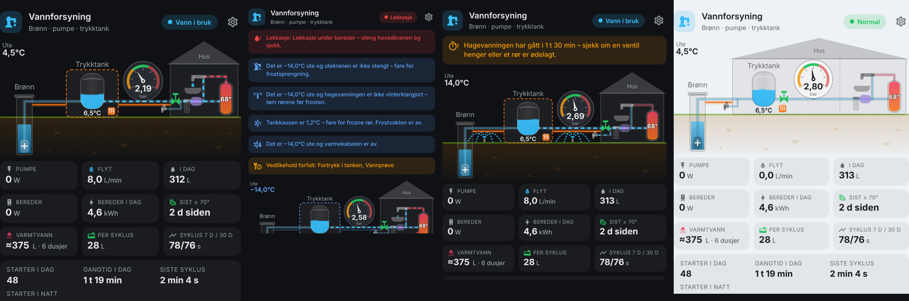

# Water System Card

A Home Assistant Lovelace card for a private water supply: well with submersible pump, pump guard, pressure tank (outdoor tank box or inside the house), main valve, house and water heater.



## Features

- Animated cutaway diagram: well, pump, pressure tank, manometer, valve, tap and water heater
- Pressure gauge with cut-in / cut-out zones
- Pump statistics: starts today, run time, last cycle, starts during the night
- Alarms: leak, pump stopped (pump guard / dry run), long run time, short cycling, low pressure, frost, heat cable off in frost
- Water heater: colour follows temperature (blue < 50 °C, amber, red ≥ 60 °C), "L" badge when legionella temperature hasn't been reached for N days
- Frost guard (tank box) and heat cable (outdoor pipes) shown separately
- 24 h pressure history with pump run strips
- Pump, main valve, frost guard, heat cable and water heater buttons (valve/pump ask for a second tap)
- Visual editor, Norwegian and English (follows HA language)

## Installation

### HACS (custom repository)

1. HACS → ⋮ → Custom repositories
2. Add this repository URL, type **Dashboard**
3. Install **Water System Card** and reload the browser

### Manual

1. Copy `water-system-card.js` to `/config/www/`
2. Settings → Dashboards → ⋮ → Resources → Add `/local/water-system-card.js?v=1.9.0` as **JavaScript module**

## HA package (recommended)

`packages/water_system.yaml` moves all alarm logic into Home Assistant, so alarms and notifications work 24/7 – also when no dashboard is open.
It adds: alarm binary sensors, pump starts/run time/night starts, last-cycle and short-cycle detection, tank drawdown (pre-charge health),
pump wear trend (7 d vs 30 d), legionella tracking, away mode (+ optional automatic valve close), actionable push notifications
("Close main valve", "Turn on heat cable" …), optional automatic heat cable, and maintenance reminders. All thresholds are helpers you can change in the UI.

1. `configuration.yaml` → `homeassistant: packages: !include_dir_named packages`
2. Copy `packages/water_system.yaml` to `/config/packages/`
3. Edit the entity IDs in **Water system config** and the notify service in `script.water_notify` (search `CHANGE ME`)
4. Restart, then set `use_package: true` in the card

## Settings panel

With `use_package: true` a ⚙ icon in the card header opens **Settings**: cut-in/cut-out, run-time and short-cycle limits, frost
and heat-cable limits, outdoor-tap frost limit, water heater set point (for `water_heater.*`/`climate.*`), hot-water limits,
legionella, night window, maintenance intervals, notifications and automation switches. Values are saved straight to the
package's helpers, so they survive restarts and are used by both the card and the HA alarms.

## UV unit, filter and outdoor tap

```yaml
uv: switch.uv_lamp            # true (just draw it) or an entity: switch/binary_sensor = lamp on, sensor = lamp hours
filter: true                  # true or a sensor (e.g. pressure drop)
outdoor_tap: valve.outdoor_tap          # true or the tap's valve/switch
outdoor_tap_shutoff: switch.tap_stop    # indoor stop valve (on/open = water in the outdoor pipe)
irrigation: switch.irrigation           # water use while this runs isn't an away alarm
tap_frost_temp: 0                       # warn below this outside if the outdoor tap isn't shut off
```

They're drawn in the house (UV glows violet when the lamp is on), the outdoor tap sprays while open and gets a blue ring when
it's at risk of freezing. With the package, UV, filter and outdoor tap are added to the maintenance list automatically
(outdoor tap = winterize in autumn / open in spring, with a guide).

## Maintenance log

Pressing **Start** (Utfør) on a maintenance item opens a form with a step-by-step guide ("How to do it"), date, measured values and notes. Saving:
- updates the item's `input_datetime` (resets the due countdown)
- default intervals: tank pre-charge every 6 months, water sample every year, UV lamp every year, filter every 6 months
- adds a completed entry to a to-do list, so the history is kept permanently and shown in the form next time

Create the list once: **Settings → Devices & services → Add integration → Local To-do**, name it `Water maintenance`
(entity `todo.water_maintenance`, picked up automatically) – or set `maintenance_log: todo.your_list`.
You can also read the history in HA's **To-do lists** panel.

Custom items and fields:

```yaml
maintenance:
  - precharge                       # built-in: pre-charge, cut-in, cut-out, adjusted to
  - sample                          # built-in: lab, result, report no.
  - name: Softener salt
    entity: input_datetime.water_last_salt
    interval_days: 60
    icon: mdi:shaker-outline
    help:                           # optional step-by-step guide shown in the form
      - Check the salt level in the brine tank.
      - Add salt until the tank is about half full.
    fields:
      - {label: Bags added, type: number}
      - {label: Brand, type: text}
      - {label: Tank cleaned, type: bool}
      - {label: Hardness, type: select, options: [Soft, Medium, Hard]}
```

## Configuration

Everything is optional; only configured parts are shown. All options are also available in the visual editor.

```yaml
type: custom:water-system-card
name: Vannforsyning
tank_location: box            # box | house
# units – sensors may report any unit; the card converts. Thresholds below are entered in these units
pressure_unit: bar            # bar | kPa | psi | mbar
temperature_unit: auto        # auto (HA setting) | °C | °F
volume_unit: L                # L | gal | m³
flow_unit: L/min              # L/min | gal/min | m³/h
power_unit: W                 # W | kW
# pump and pressure
pressure: sensor.bod_monitor_pressure
pump_power: sensor.pump_power       # or pump_current / pump_running
pump_guard: binary_sensor.pumpevakt_alarm   # optional, otherwise inferred
pump_switch: switch.pump
valve: valve.main_water
# frost, leaks, usage
temperature: sensor.bod_monitor_pressure_tank_box
outdoor_temp: sensor.bod_monitor_outside
frost_guard: switch.frostvakt
heat_trace: switch.varmekabel
# leak sensors per location (box, house, heater, well, pipe) – shown as drip + puddle there
leak_box: [binary_sensor.leak_tank_box]
leak_heater: [binary_sensor.leak_water_heater]
leak_house: [binary_sensor.leak_kitchen, binary_sensor.leak_bathroom]
flow: sensor.water_flow
water_today: sensor.water_today
# water heater
water_heater: switch.vvb            # or water_heater.* / climate.*
water_heater_temp: sensor.vvb_temp
water_heater_power: sensor.vvb_power
water_heater_energy: sensor.vvb_energy_today
# thresholds (defaults shown)
cut_in: 2.0
cut_out: 3.5
max_pressure: 6
min_temp: 3
trace_warn_temp: 5        # heat cable off and outside below this → warning
guard_warn_temp: 5        # frost guard off and tank box below this → warning
power_threshold: 50
current_threshold: 0.5
max_run_minutes: 20
short_cycle_seconds: 30
guard_delay: 90
night_start: 1
night_end: 5
night_starts_warn: 4
water_heater_low_temp: 50
water_heater_ok_temp: 60
legionella_temp: 70
legionella_days: 7
history_hours: 24
confirm: [pump, valve, frost_guard, heat_trace, water_heater]   # or true / false
# package + extras
use_package: true             # read alarms from packages/water_system.yaml
compact: false                # header + drawing only, tap to expand
away: input_boolean.water_away
water_heater_volume: 200      # shows ≈ litres of 40 °C water and number of showers
shower_liters: 60
cold_water_temp: 8
drawdown: sensor.water_tank_drawdown_avg       # filled in automatically with use_package
drawdown_min: 15                               # warn if no package
maintenance: [precharge, sample, uv, filter]   # or [{name, entity: input_datetime.x, interval_days}]
show_events: true
events_count: 8
# hide features
show_valve: true
show_pump_guard: true
show_frost_guard: true
show_heat_trace: true
show_water_heater: true
show_leak: true
show_outdoor: true
show_labels: true
show_tiles: true
show_stats: true
show_history: true
show_controls: true
```

The legionella check reads hourly long-term statistics for `water_heater_temp`, so the sensor needs a `state_class` (ESPHome/most integrations set this for temperatures).

## Updating

Bump the version in `water-system-card.js`, commit, and create a GitHub release (e.g. `v1.3.1`). HACS picks up new releases.
